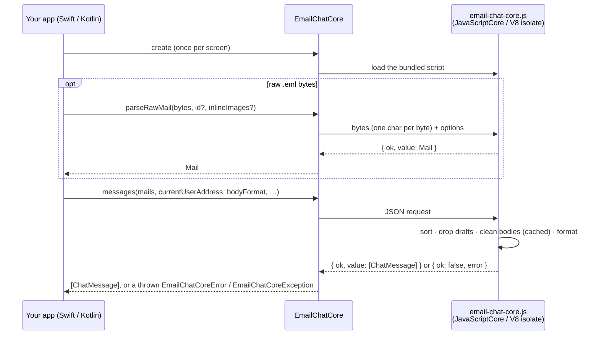

# email-chat-view on iOS and Android

The chat view from this package, in a native app. It is not a port. The
transform, the React view and the stylesheet are the ones the npm package
ships, bundled into one HTML page that a `WKWebView` (iOS) or `WebView`
(Android) loads from the app bundle, with no network. A thin native wrapper on
each platform gives you typed models in and typed events out.

```
src/ (TypeScript)
  └─ pnpm build:mobile ─▶ email-chat-view.html  (React + view + transform + CSS, one file)
                            ├─ iOS      Swift package   EmailChatThread / EmailChatWebView
                            └─ Android  library module  EmailChatView
```

So a rule fix or a bubble change reaches web, iOS and Android together, and
there is no Swift or Kotlin reimplementation to keep in step.

**Two ways in**, from the same library:

| | WebView view | Data only — `EmailChatCore` |
| --- | --- | --- |
| You get | the finished chat UI | `[ChatMessage]` — you draw the bubbles |
| Runs in | `WKWebView` / `WebView` | JavaScriptCore (iOS) / sandboxed V8 isolate (Android) |
| Body format | rich text | rich text (default) or plain text |
| Raw `.eml` input | parse with `EmailChatCore`, then render | `parseRawMail` |
| Requires | iOS 15+ · Android API 24+ | iOS 15+ · Android API 26+ |

Pick the view for the fastest integration; pick
[`EmailChatCore`](#data-only-emailchatcore) when your design system owns the
bubbles. Both can live in one app.

## The model

- **In:** a `ThreadState`, sent whole on every change: the mails, the reader's
  address, paging flags, tokens. Nothing is patched. Change your mails and render
  again. Bodies the page has already cleaned are cached by content, so
  re-sending a thread costs almost nothing.
- **Out:** `ChatEvent`s. Every event names a **mail id**, never a bubble. One
  bottom-quoted mail can become several bubbles, and your app only knows the mails
  it fetched.

| Event | When | What the app does |
| --- | --- | --- |
| `openLink(url)` | a link in a message is tapped | open it (browser, in-app tab) |
| `visibleRange(mailIds)` | the visible bubbles change | fetch those bodies first |
| `loadOlder` | the top is reached while `hasOlder` | fetch older mails, render again |
| `retryBody(mailId)` | retry tapped on a failed body | refetch, render again |
| `previewAttachment(attachment, mailId)` | eye icon on an attachment | show a preview |
| `downloadAttachment(attachment, mailId)` | download icon | download it |

Bodies can arrive later. Send a mail with `bodyPending = true` and no body, and
its bubble shows a spinner until you render it again with the body.

## Integrating it, step by step

The same five steps on both platforms. The code for each platform follows.

1. **Add the dependency.** Swift Package Manager on iOS, JitPack on Android.
   Use the same version on both, so both apps ship the same page.
2. **Map your mail model to `Mail`.** One `Mail` per message in the thread,
   oldest first: `id` (any id that is stable for that message), `fromAddress`,
   `date`, and the HTML `body`. Add `fromName`, `toAddress`/`toNames`, `ccAddress`/`ccNames`,
   `messageId` and `attachments` when you have them. Do not pre-clean the HTML.
   Stripping quotes, signatures and tracking is the library's job.
3. **Build a `ThreadState` and render it.** Set `currentUserAddress` to every
   address the reader sends from, so their own messages show as "mine". Render
   again whenever anything changes: a body arrives, older mails load, paging
   flags flip. Always send the whole thread. Nothing is patched.
4. **Handle the events.** At minimum, `openLink` (nothing opens without it)
   and `visibleRange` (fetch those bodies). Add `loadOlder` if you page, and
   the attachment events if you show attachments. See the table above.
5. **Theme it (optional).** Pass `tokens` for brand colours and `labels` for
   translated strings. Dark mode needs nothing.

Bodies can be lazy. Send a mail with `bodyPending = true` and no `body`, fetch
it when `visibleRange` names its id, then render again with the body. If the
fetch fails, set `bodyFailed = true`. The bubble then offers retry, which comes
back as `retryBody`.

Checklist before you ship:

- [ ] Links open: `openLink` is handled. The view never navigates itself.
- [ ] Your own messages are on the right: `currentUserAddress` is set.
- [ ] Older mail loads: `hasOlder` and `loadingOlder` are set, and `loadOlder` is handled.
- [ ] Android: the view is destroyed with its screen (`destroy()`, or `onRelease` in Compose).
- [ ] Android release build: run it once minified and tap a link. If links do
      nothing, R8 stripped the bridge (see below).

## iOS (Swift)

Requires iOS 15+ (macOS 12+ also works). On iOS 15.0 to 16.1, WebKit has no
`color-mix()`, so a designed (newsletter-style) mail is printed on the plain
surface rather than on a page in the sender's colour. The tinted border still
marks whose mail it is. Everything else looks the same.

**Install.** In Xcode, choose **File → Add Package Dependencies…**. Enter
`https://github.com/Sarv/email-chat-view.git`, choose **Up to Next Major
Version** from `0.3.0`, and add the `EmailChatView` library to your app target.
In a `Package.swift`:

```swift
dependencies: [
    .package(url: "https://github.com/Sarv/email-chat-view.git", from: "0.3.0"),
],
targets: [
    .target(name: "App", dependencies: [
        .product(name: "EmailChatView", package: "email-chat-view"),
    ]),
]
```

The package resolves straight from the git tag. The page is a bundled
resource, so there is nothing to download at run time and no Info.plist entry
to add.

**Map your model:**

```swift
import EmailChatView

extension Mail {
    init(_ message: StoredMessage) {          // StoredMessage: your own type
        self.init(
            id: message.uid,
            fromAddress: message.from.address,
            date: message.date,
            fromName: message.from.name,
            toAddress: message.to.map(\.address).joined(separator: ", "),
            body: message.html,                  // nil until fetched
            attachments: message.files.map {
                Attachment(filename: $0.name, sizeBytes: $0.size, mimeType: $0.type)
            },
            bodyPending: message.html == nil
        )
    }
}
```

SwiftUI:

```swift
import EmailChatView

struct ThreadScreen: View {
    @ObservedObject var store: ThreadStore
    @Environment(\.openURL) private var openURL

    var body: some View {
        EmailChatThread(
            state: ThreadState(
                mails: store.mails,              // [Mail]; `date` is a Date
                currentUserAddress: [store.me],
                hasOlder: store.hasOlder,
                loadingOlder: store.loadingOlder
            )
        ) { event in
            switch event {
            case .openLink(let url): openURL(url)
            case .visibleRange(let ids): store.fetchBodies(ids)
            case .loadOlder: store.loadOlder()
            case .retryBody(let id): store.fetchBodies([id])
            case .previewAttachment(let file, let id): store.preview(file, in: id)
            case .downloadAttachment(let file, let id): store.download(file, in: id)
            case .ready: break
            }
        }
        .ignoresSafeArea(edges: .bottom)
    }
}
```

UIKit: `EmailChatWebView` is a `UIView`. Set `onEvent`, call `render(_:)`.

## Android (Kotlin)

Requires minSdk 24 and a system WebView based on Chromium 90+. The WebView
updates through the Play Store, so this is nearly every device in use. Below
Chromium 111, designed mails get the same plain-page fallback as iOS 15.

**Install.** The library is published on JitPack from each release tag. Add
the repository in `settings.gradle.kts`:

```kotlin
dependencyResolutionManagement {
    repositories {
        google()
        mavenCentral()
        maven("https://jitpack.io")
    }
}
```

Then add the dependency in the app module's `build.gradle.kts`. The version is
the git tag, `v` included:

```kotlin
dependencies {
    implementation("com.github.Sarv:email-chat-view:v0.3.0")
}
```

The AAR carries the page as an asset and its own R8 rule. You add no
permissions: the page loads from the APK and makes no network requests.

To work against an unreleased checkout instead, include the module from source:

```kotlin
// settings.gradle.kts
include(":emailchatview")
project(":emailchatview").projectDir = file("../email-chat-view/mobile/android/emailchatview")
// app/build.gradle.kts
implementation(project(":emailchatview"))
```

**Map your model:**

```kotlin
import com.sarv.emailchatview.Attachment
import com.sarv.emailchatview.Mail

fun StoredMessage.toMail() = Mail(          // StoredMessage: your own type
    id = uid,
    fromAddress = from.address,
    fromName = from.name,
    toAddress = to.joinToString(", ") { it.address },
    dateMillis = date.toEpochMilli(),
    body = html,                            // null until fetched
    attachments = files.map { Attachment(it.name, it.size, it.type) },
    bodyPending = html == null,
)
```

Jetpack Compose:

```kotlin
@Composable
fun ThreadScreen(store: ThreadStore) {
    val context = LocalContext.current
    AndroidView(
        factory = { EmailChatView(it) },
        update = { view ->
            view.onEvent = { event ->
                when (event) {
                    is ChatEvent.OpenLink ->
                        context.startActivity(Intent(Intent.ACTION_VIEW, Uri.parse(event.url)))
                    is ChatEvent.VisibleRange -> store.fetchBodies(event.mailIds)
                    ChatEvent.LoadOlder -> store.loadOlder()
                    is ChatEvent.RetryBody -> store.fetchBodies(listOf(event.mailId))
                    is ChatEvent.PreviewAttachment -> store.preview(event.attachment, event.mailId)
                    is ChatEvent.DownloadAttachment -> store.download(event.attachment, event.mailId)
                    ChatEvent.Ready -> Unit
                }
            }
            view.render(
                ThreadState(
                    mails = store.mails,           // List<Mail>; dateMillis is epoch ms
                    currentUserAddress = listOf(store.me),
                    hasOlder = store.hasOlder,
                    loadingOlder = store.loadingOlder,
                ),
            )
        },
        onRelease = { it.destroy() },
    )
}
```

Views: `EmailChatView` is a `FrameLayout`. Set `onEvent`, call `render(...)`,
and call `destroy()` in `onDestroy`.

The module ships a consumer R8 rule that keeps the bridge method. Without it,
a minified release build would drop every event.

## Data only: `EmailChatCore`

For a team that wants the conversation as **data** and builds the UI natively.
`EmailChatCore` loads `email-chat-core.js` — the same transform the view runs,
plus the raw-mail parser, with no React and no DOM — into the platform's own
JavaScript engine. No WebView is created and nothing touches the network.

It has two methods, one per kind of input:

| You have | Call | You get |
| --- | --- | --- |
| Raw mail: `.eml` bytes, an IMAP `BODY[]` | `parseRawMail(bytes)` | a `Mail` |
| Mail as fields (from, to, date, HTML body) from your API or database | nothing: build the `Mail` yourself, exactly as for the view ([iOS](#ios-swift), [Android](#android-kotlin) "Map your model") | a `Mail` |
| Either, as a list of `Mail` | `messages(mails, …)` | cleaned `ChatMessage`s, in HTML or plain text |

There is no separate "parse HTML" step: `messages` is it. It strips quoted
history and signatures, dedupes and sorts the thread, and sets `isFromMe`.



Keep **one instance per screen**: it remembers every body it has cleaned, so
re-sending the whole thread when one body arrives only cleans that body. Calls
are serialized, so it is safe to call from any task or coroutine.

### iOS

```swift
import EmailChatView

let core = try EmailChatCore()   // an actor; create once, keep it

// From an .eml file, or the source your IMAP library fetched.
let mail = try await core.parseRawMail(try Data(contentsOf: emlURL), id: uid)

let messages = try await core.messages(
    from: storedMails + [mail],
    currentUserAddress: ["me@acme.example"],
    bodyFormat: .text          // .html (default) for rich text
)

for message in messages {
    print(message.fromName ?? message.fromAddress, message.date ?? "unknown date", message.body)
}
```

Failures throw `EmailChatCoreError` (its `message` says what went wrong).

### Android

```kotlin
if (!EmailChatCore.isSupported()) {
    // API < 26, or a WebView too old to provide the JavaScript sandbox:
    // fall back to EmailChatView, which works from API 24.
    return
}

// In a coroutine. Close it when the screen goes away: it holds an isolate.
val core = EmailChatCore.create(context)
try {
    val mail = core.parseRawMail(emlFile.readBytes(), id = uid)
    val messages = core.messages(
        storedMails + mail,
        currentUserAddress = listOf("me@acme.example"),
        bodyFormat = BodyFormat.TEXT,   // BodyFormat.HTML (default) for rich text
    )
    adapter.submitList(messages)
} finally {
    core.close()
}
```

Failures throw `EmailChatCoreException`. `create` is annotated
`@RequiresApi(26)`; call `isSupported()` first. The library's own `minSdk`
stays 24 — the sandbox dependency is only used behind that check.

### Options and models

`messages(...)`:

| Parameter | Default | Effect |
| --- | --- | --- |
| `mails` | — | the thread, in any order |
| `currentUserAddress` | empty | the reader's addresses; their messages get `isFromMe == true` (nil/null with none given) |
| `bodyFormat` | `html` | `html`: cleaned rich text for an HTML renderer. `text`: the same cleaned body as plain text, lines and list bullets kept |
| `containsThreadStart` | `true` | the oldest mail really starts the thread, so its quoted history is kept |
| `includeDrafts` | `false` | keep drafts as messages |

`parseRawMail(bytes, id, inlineImages)` returns a `Mail`. `id` defaults to the
Message-ID. `inlineImages` (default true) turns `cid:` images into `data:`
URIs so a signature logo shows. `To`/`Cc` come back in header form,
attachments with their sizes, and a body-referenced image marked `inline`.

`ChatMessage` mirrors the web type: `id`, `fromAddress`, `fromName`,
`toAddress`/`toNames`, `ccAddress`/`ccNames`, `date` (`Date?` on iOS,
`dateMillis: Long?` on Android), `dateApprox`, `body`, `attachments`,
`isFromMe`, `bodyPending`, `bodyFailed`, `applied` (the rules that shaped the
body) and `sourceId`.

### Limits

- **Charsets.** The native engines have no `TextDecoder`, so the core brings
  its own for UTF-8, UTF-16 and windows-1252 (which covers ISO-8859-1 and
  US-ASCII). A body in another legacy charset (Shift_JIS, GB2312, KOI8-R, …)
  decodes as windows-1252, so its non-Latin text comes out garbled. *Why:* the
  legacy charset tables (as `iconv-lite` ships them) are about 350 KB, which
  would double the core for every app, and almost all mail today is UTF-8. The web and Node use the
  platform's decoder and have no such limit, so a host that must read such mail
  can parse it there.
- **Undated mail.** A raw mail with neither a `Date` nor a `Received` header
  parses with date `0`, and `messages` reports that as an unknown (nil/null)
  date, sorted last.
- **Android verification.** The Android core is unit-tested against the real
  `email-chat-core.js` in GraalJS, through the same chunked transport it uses
  on a device. Run it on your minimum supported device before relying on it.
- **Big threads.** Requests and replies cross the engine boundary as strings.
  Large inline images in raw mails make them large; pass `inlineImages: false`
  if you resolve `cid:` yourself.
- **No streaming or partial results.** `messages` returns the whole thread at
  once. That matches the web transform, and the body cache keeps a re-send
  cheap.

## Platform support: what, and why not lower

| | Minimum | Set by |
| --- | --- | --- |
| iOS view (`EmailChatThread`, `EmailChatWebView`) | iOS 15, macOS 12 | the web engine the page is built for |
| iOS data (`EmailChatCore`) | iOS 15, macOS 12 | the same — JavaScriptCore is Safari's engine |
| Android view (`EmailChatView`) | API 24 (Android 7.0) + a Chromium 90+ System WebView | our tested floor |
| Android data (`EmailChatCore`) | API 26 (Android 8.0) + a WebView that ships the JavaScript sandbox | `androidx.javascriptengine` |

**iOS 15.** The Swift code itself is not the limit; it compiles for iOS 14.
The limit is the web engine, which is part of the OS on iOS and cannot be
updated separately:

- The page and the core are built for Safari 15 (`target` in
  `tsup.config.ts`). The build fails on any syntax iOS 15 cannot run, so
  "supports iOS 15" is checked on every build, not just stated.
- iOS 14.0–14.4 has no flexbox `gap`, which the bubble and header layout uses
  throughout; the conversation would render with its spacing collapsed.
- We have no iOS 14 simulator in our toolchain or CI, and we do not claim a
  floor we cannot run.
- iOS 15.0–15.3 lack `Object.hasOwn`, which the core's HTML parser uses; the
  core installs a small stand-in for it, so all of iOS 15 works.
- iOS 15.0–16.1 lack CSS `color-mix()`. A designed mail prints on the plain
  surface there (see [iOS](#ios-swift)); everything else is identical.

**Android view: API 24.** Here the web engine is the System WebView, which
updates from the Play Store separately from the OS, so the floor is about the
WebView rather than the API level. The Kotlin code uses nothing above API 21
(Android lint passes at `minSdk 21`), but older Android releases stop receiving
WebView updates and are left on engines older than the Chromium 90 the page is
built for. API 24 is the floor we test. A team that needs API 21–23, and whose
devices carry an up-to-date WebView, can ask for it to be lowered.

**Android data: API 26.** `androidx.javascriptengine`, which provides the
sandboxed V8 isolate, declares `minSdk 26` itself, and the isolate runs inside
the WebView package, so an old WebView cannot provide one either. That is why:

- The library keeps `minSdk 24` for the view and overrides the engine's floor
  in its manifest. The engine is only touched behind `EmailChatCore.isSupported()`.
- `isSupported()` is false on API 24–25 or with a WebView too old for the
  sandbox. Fall back to the WebView view there, or parse on your server.
- There is no other engine to fall back to: running JavaScript in a hidden
  WebView would bring back everything `EmailChatCore` exists to avoid, and
  bundling a JavaScript engine of our own would add megabytes to every app.

## Theming

- **Dark mode** follows the app. The page uses `prefers-color-scheme`, which
  both WebViews take from the app's current appearance.
- **Brand colours** go through `tokens`. The names are this package's CSS
  tokens without the leading dashes (`brand`, `surface`, `ink`, `border`,
  `sec-bubble-mine-bg`, …; see `src/styles/index.css`):

  ```swift
  ThreadState(mails: mails, tokens: ["brand": "#0b57d0"])
  ```

- **Strings** go through `labels`, keyed as `ViewLabels` in `src/ui/labels.ts`
  (`today`, `retry`, `loadImages`, …).

Remote images stay blocked until the reader taps "load images", as on the web.
Set `blockRemoteImages = false` to load them up front.

## Not available on mobile

The React-only props (`renderActions`, `renderHeaderMeta`, `renderFooter`) take
React elements, which cannot cross a WebView bridge. Put per-message controls
in native UI around the view, keyed by the mail ids the events report.

## Releasing

One tag releases npm, iOS and Android together:

```sh
npm version 0.3.0        # bumps package.json, rebuilds the mobile page, commits both, tags v0.3.0
git push --follow-tags   # the Publish workflow takes it from here
```

The `version` hook in `package.json` runs `pnpm build:mobile` and stages the
page, so the bump commit always carries a page built from the same source. The
Publish workflow then does the rest:

1. `swift test` on macOS, and the Android unit tests, lint and a local publish.
2. The usual type-check, 100% coverage and build. Then `pnpm check:mobile`
   fails the release if the committed page does not match `src/`.
3. npm publish.
4. JitPack builds `com.github.Sarv:email-chat-view:v0.3.0`. The workflow waits
   for the artifact and prints JitPack's build log if it fails.
5. A GitHub release with generated notes.

iOS needs no upload step: Swift Package Manager resolves the tag directly. CI
also runs `pnpm check:mobile`, `swift test` and the Android build on every push,
so a stale page is caught on the commit that caused it.

## Working on it

The page lives at `mobile/ios/Sources/EmailChatView/Resources/email-chat-view.html`.
It is generated, and it is committed because SwiftPM never runs npm. The
Android module reads its assets from the same folder. After changing anything
in `src/`:

```sh
pnpm build:mobile                # rebuild the page and email-chat-core.js, then commit them with the change
swift test                       # iOS wrapper + the page in real WebKit at 390px wide
pnpm check:mobile                # fails if the committed page is stale
cd mobile/android && ./gradlew :emailchatview:testDebugUnitTest
```

`src/mobile/` is the page's side of the bridge (tested with the rest of the
suite). `Bridge.swift` and `Bridge.kt` mirror it on each platform.
`src/mobile/core.ts` is the data core's JavaScript side; `EmailChatCore.swift`,
`EmailChatCore.kt` and `CoreProtocol.kt` are its native side.
